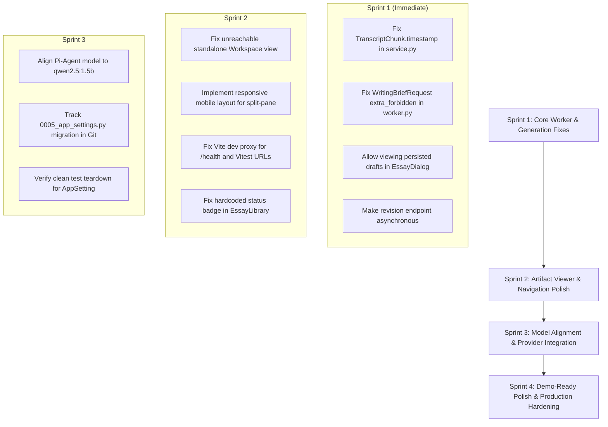

# The Lenny Growth Assistant — Comprehensive Product, Architecture, Reliability, and UX Audit Report

**Audit Date:** October 12, 2026  
**Auditor:** Antigravity Autonomous Diagnostic Engine  
**Repository:** `E:\Lenddy's Growth assistant`  
**Git Commit Baseline:** `1e7a07b` (working copy with local modifications and untracked files inspected)  
**Docker Stack Status:** Active (PostgreSQL 17 + pgvector, Redis 7, FastAPI API, Writing Worker, Pi Agent, React/Nginx Frontend)  

---

## Section 1 — Executive Summary

### 1.1 Release Status Assessment
**Current Status: Runnable with Major Defects**

The Lenny Growth Assistant represents a sophisticated full-stack architecture with a working conversational RAG pipeline, transcript search across 303 episodes / 17,365 chunks, pgvector embeddings, and asynchronous Redis queue processing. However, it currently suffers from **critical defects in its primary writing and artifact workflow** that prevent it from being release-ready or demo-ready:

1. **Essay Generation Breaks Frequently:**
   - **Session-Grounded Failure:** Triggering "Create essay" from an ongoing chat conversation with grounded citations causes an immediate unhandled `AttributeError` in the background worker (`TranscriptChunk.timestamp` does not exist on the database model), causing worker crashes and requeuing loops.
   - **Payload Deserialization Corruption:** Writing brief job snapshots inject model/provider keys into `brief_payload` that violate strict Pydantic schemas (`extra="forbid"` on `WritingBriefRequest`), causing instant job failure.
   - **Quality Gate False-Rejections:** The deterministic quality gate rejects essays with strict +/-10% word-count boundaries (e.g. 540 or 880 words for a 650-word target). When rejected, `EssayDialog.tsx` displays a generic error banner and refuses to open or present the generated draft to the user—despite high-quality text and valid citations having been persisted in PostgreSQL.
2. **Synchronous Revision API Induces Network Timeouts:**
   - The AI revision endpoint (`POST /api/v1/writing/artifacts/{id}/revisions`) executes heavy LLM inference synchronously on the FastAPI web server thread rather than dispatching to the background worker. Local inference with Ollama takes 35–65 seconds, exceeding client timeouts and causing `504 Gateway Timeout` or `NETWORK_ERROR` failures in the frontend.
3. **Artifact Viewer Layout & Navigation Breakages:**
   - The standalone `workspace` view in `App.tsx` is completely unreachable dead code; opening artifacts forcibly switches users to the chat view with a split-panel.
   - The split-panel layout lacks mobile responsiveness, causing severe horizontal clipping on viewport widths under 680px.
4. **Agent Orchestrator Model Mismatch:**
   - The Pi Agent service is configured to invoke `qwen3.5:9b` (a 6.6 GB model) rather than the lightweight `qwen2.5:1.5b`. Multi-turn tool execution frequently exceeds the 360-second execution timeout, resulting in dropped requests.

---

## Section 2 — Architecture and Feature Inventory

| Component / Subsystem | Responsibilities & Critical Dependencies | Status | Evidence / Verification Notes |
| :--- | :--- | :--- | :--- |
| **Frontend: React Bootstrap & Shell** | Vite, React 18, TypeScript, SPA routing in `App.tsx`, `Header.tsx`, `Sidebar.tsx`. | **Verified** | Builds successfully (`npm run build`). Vite dev proxy only routes `/api/`, leaving `/health` unproxied. |
| **Frontend: Chat & RAG Experience** | `ChatView.tsx`, `SourcesSection.tsx`, conversational streaming/rendering, source citation cards. | **Verified** | Chat flow connects to backend; retrieves and renders grounded transcript citations; preserves user messages. |
| **Frontend: Essay Composer Dialog** | `EssayDialog.tsx`, modal brief configuration, asynchronous job submission, polling logic. | **Failed** | Submits brief to `/api/v1/writing/essays`, but on quality gate failure or worker crash, suppresses artifact opening and displays generic error. |
| **Frontend: Artifact Viewer / Workspace** | `Workspace.tsx`, `MarkdownEditor.tsx`, `HtmlPreview.tsx`, `RevisionBar.tsx`, version drawers. | **Partially Verified** | Manual markdown editing and version saving work; iframe sandboxing (`allow-popups`) secure; standalone view unreachable; mobile split-panel broken. |
| **Frontend: Essay Library** | `EssayLibrary.tsx`, lists artifacts from `/api/v1/writing/artifacts`. | **Partially Verified** | Displays saved artifacts; hardcodes `status-completed` CSS class even for `failed` artifacts; opening artifact forces chat split-pane. |
| **FastAPI Backend Core** | `main.py`, `deps.py`, dependency injection, lifecycle management, CORS, error handling. | **Verified** | Starts cleanly on port 8000; health endpoints `/health/live` and `/health/ready` operational. |
| **Chat & Sessions API** | `sessions.py`, `chat.py`, `/api/v1/sessions`. Message persistence and history management. | **Verified** | Atomic persistence of user and assistant messages verified; isolation between sessions verified. |
| **RAG Retrieval Engine** | `search.py`, `service.py`, cosine similarity over pgvector embeddings, citation mapping. | **Verified** | Correctly maps chunks, handles ungrounded queries with explicit abstention, validates citation indices against retrieved chunks. |
| **Model / Provider Selector** | `settings_llm.py`, `Header.tsx`, `app_settings` table. Runtime provider inspection & testing. | **Partially Verified** | Database table `app_settings` exists; switching to unconfigured NVIDIA NIM correctly rejected with 400 Bad Request; Ollama test passes (28ms). |
| **Background Job Processing** | `job_runner.py`, `worker.py`, Redis queue `lenny:writing:jobs`, durable PostgreSQL tracking. | **Failed** | Worker claims jobs, but crashes on `TranscriptChunk.timestamp` and fails jobs on `WritingBriefRequest` extra validation error. |
| **Pi Coding Agent Service** | `agent-service`, Node.js 22, TypeScript, internal token auth, tool execution. | **Partially Verified** | Compiles and passes 7 vitest tests; live service accessible on port 3000; tool execution works but times out with 9B model. |
| **PostgreSQL 17 + pgvector** | 303 episodes, 17,365 chunks, `VECTOR(768)` index, migration revision `0005_app_settings`. | **Verified** | Verified via `scripts/check_database.py`. All relational constraints, vector dimensions, and indexes intact. |
| **Deployment Hygiene & Docker** | `compose.yaml`, `compose.prod.yaml`, `Dockerfile`, `.github/workflows/ci.yml`. | **Partially Verified** | Compose services run healthy; container code baked in at build time (no live host volume mounts); CI executes full matrix. |

---

## Section 3 — Confirmed Defects

### BUG-001: Worker Crash on Session-Grounded Essay Generation (`AttributeError: 'TranscriptChunk' object has no attribute 'timestamp'`)
- **Severity:** P1
- **Affected Feature:** Essay Generation from Chat Sessions
- **User-Visible Impact:** Clicking "Create essay" from an existing chat message causes essay generation to fail immediately. The dialog reports a failure after repeated worker retries.
- **Reproduction Steps:**
  1. Open the Chat view and ask a question (e.g., "What is product market fit?").
  2. Click the "Create essay" contextual button below the grounded assistant answer.
  3. Keep the populated topic, select target word count, and click "Generate Essay".
  4. Inspect the background worker logs.
- **Expected vs. Actual Behavior:**
  - *Expected:* Worker extracts cited session chunks and generates an essay grounded in the session dialogue.
  - *Actual:* Worker raises `AttributeError: 'TranscriptChunk' object has no attribute 'timestamp'` at `backend/app/writing/service.py:144` (`get_session_grounded_context`), retries 2 times, and marks the job failed.
- **Root Cause:**
  `TranscriptChunk` ORM model (`backend/app/models.py:147`) has no `timestamp` column. It defines `start_time_seconds`. The code at line 144 of `backend/app/writing/service.py` erroneously accessed `chunk_row.timestamp` instead of formatting `start_time_seconds` via `format_seconds_to_timestamp`.
- **Evidence:**
  ```text
  worker-1 | File "/app/backend/app/writing/service.py", line 144, in get_session_grounded_context
  worker-1 |   timestamp=chunk_row.timestamp,
  worker-1 | AttributeError: 'TranscriptChunk' object has no attribute 'timestamp'
  ```
- **Confidence:** Confirmed
- **Recommended Fix:** In `backend/app/writing/service.py`, compute `timestamp` from `chunk_row.start_time_seconds` (or use `format_seconds_to_timestamp(chunk_row.start_time_seconds)`) instead of accessing non-existent attribute.
- **Acceptance Criteria:** Submitting a writing brief with a valid `session_id` containing cited transcript chunks completes research without raising `AttributeError`.

---

### BUG-002: Worker Rejection of Job Brief Due to Snapshot Payload Schema Violation
- **Severity:** P1
- **Affected Feature:** Background Essay Queue Processing
- **User-Visible Impact:** Jobs queued for execution fail immediately before research starts with an "Invalid brief" error.
- **Reproduction Steps:**
  1. Queue an essay job via `job_runner.py:submit_job`.
  2. Inspect the worker log when `_process_job` dequeues the item.
- **Expected vs. Actual Behavior:**
  - *Expected:* The worker parses the brief payload and executes the job.
  - *Actual:* Worker throws Pydantic `extra_forbidden` validation error and marks the job failed.
- **Root Cause:**
  In `backend/app/writing/job_runner.py` (lines 184–191), `submit_job` modifies `brief_payload` by inserting `_snapshot_provider` and `_snapshot_model`. When the worker deserializes this dictionary at `backend/app/writing/worker.py:148` via `WritingBriefRequest(**brief_data)`, Pydantic rejects it because `WritingBriefRequest` (`backend/app/writing/schemas.py:26`) specifies `model_config = ConfigDict(extra="forbid")`.
- **Evidence:**
  ```text
  worker-1 | [ERROR] [lenny_writing_worker] Corrupted brief payload for job job_c42363294e5e: 2 validation errors for WritingBriefRequest
  worker-1 | _snapshot_model: Extra inputs are not permitted [type=extra_forbidden]
  worker-1 | _snapshot_provider: Extra inputs are not permitted [type=extra_forbidden]
  ```
- **Confidence:** Confirmed
- **Recommended Fix:** Either permit extra fields in `WritingBriefRequest` (`extra="ignore"`), sanitize the brief payload before instantiating `WritingBriefRequest` in `worker.py`, or store snapshot metadata in separate job columns/metadata fields rather than inside the brief payload.
- **Acceptance Criteria:** Jobs containing snapshot metadata are successfully parsed and executed by the worker.

---

### BUG-003: Deterministic Quality Gate Rejection Suppresses Persisted Drafts in UI
- **Severity:** P1
- **Affected Feature:** Ship 30 for 30 Essay Composer & Viewer Transition
- **User-Visible Impact:** Generating an essay for a topic such as `David` with target 650 words results in an error alert: *"The essay did not meet the required quality checks... (Job ID: job_38e95d562988)"*. The user is left in the modal with no way to view or edit the persisted essay draft.
- **Reproduction Steps:**
  1. Open the essay dialog.
  2. Enter topic `David`, word count 650.
  3. Click "Generate Essay".
  4. Wait for polling to reach terminal state.
- **Expected vs. Actual Behavior:**
  - *Expected:* Even if the essay deviates slightly from the target word count (e.g. 540 words vs [585, 715] range), the draft should be presented in the Artifact Viewer with non-blocking feedback and quality diagnostics so the user can refine it.
  - *Actual:* The job and artifact are marked `status: 'failed'`. `EssayDialog.tsx` treats `failed` as an unrecoverable failure, suppresses opening the Artifact Viewer, and leaves 70+ failed drafts abandoned in the database.
- **Root Cause:**
  `evaluator.py` enforces a rigid +/-10% word-count threshold and binary pass/fail criteria. When `evaluation.passed` is false after 1 revision attempt, `job_runner.py` sets `job.status = "failed"`. `EssayDialog.tsx:58` only invokes `onEssayCreated` if `terminalJob.status === 'completed'`.
- **Evidence:**
  - Confirmed via live execution of `job_38e95d562988`:
  ```text
  worker-1 | Persisted writing artifact id=997177a6-cc7c-4be8-9881-e50891ec79fa v=1 for topic 'David' (wc=540)
  worker-1 | Durable essay job job_38e95d562988 failed quality evaluation: Mandatory quality evaluation failed: Body word count (540) is outside acceptable target range [585, 715] (target: 650).
  ```
  - Database contains 70 artifacts, of which the vast majority are marked `failed` despite having complete markdown content and verified citations.
- **Confidence:** Confirmed
- **Recommended Fix:** If an artifact is persisted (`terminalJob.artifact_id` exists), `EssayDialog` should transition the user to the Artifact Viewer with the evaluation feedback displayed in the "Out of Target" badge, allowing iterative manual and AI revisions.
- **Acceptance Criteria:** Generated essays that fail word-count thresholds are accessible in the Artifact Viewer with clear diagnostic feedback rather than terminating in a blocked modal dialog.

---

### BUG-004: Synchronous Essay Revision Endpoint Induces HTTP Client Timeouts
- **Severity:** P1
- **Affected Feature:** Artifact Viewer AI Revision Bar (`RevisionBar.tsx`)
- **User-Visible Impact:** Clicking a revision chip or submitting instructions in the Artifact Viewer causes the UI to hang with "Revising..." until a timeout error occurs.
- **Reproduction Steps:**
  1. Open an existing artifact in the Artifact Viewer.
  2. Click a quick refinement preset chip (e.g. "Sharpen tone to be more analytical and actionable").
  3. Observe network request `POST /api/v1/writing/artifacts/{id}/revisions`.
- **Expected vs. Actual Behavior:**
  - *Expected:* The revision completes within interactive HTTP timeouts or is processed asynchronously with progress polling.
  - *Actual:* The endpoint runs full Ollama inference synchronously on the API server thread. The request exceeds 45–60s, triggering client-side ReadTimeout / Network Error.
- **Root Cause:**
  `backend/app/api/routes/writing.py:448` implements `revise_artifact` as a synchronous endpoint that blocks on `self.chat_client.generate_chat_response()`. It does not utilize the Redis background worker.
- **Evidence:**
  ```text
  requests.exceptions.ReadTimeout: HTTPConnectionPool(host='127.0.0.1', port=8000): Read timed out. (read timeout=45)
  ```
- **Confidence:** Confirmed
- **Recommended Fix:** Convert artifact revisions to use the durable background job runner (`job_runner.py`), returning a 202 Accepted response with job polling, or stream progress via SSE/WebSockets.
- **Acceptance Criteria:** Submitting a revision instruction returns immediately with a tracking job ID or completes reliably without blocking the FastAPI HTTP event loop.

---

### BUG-005: Unreachable Standalone Workspace View & Dead Header Navigation
- **Severity:** P2
- **Affected Feature:** Frontend Navigation & Document Focus
- **User-Visible Impact:** Artifacts can only be viewed in a cramped 50/50 split-panel beside the chat conversation. The user cannot maximize the editor or access a dedicated full-width writing workspace.
- **Reproduction Steps:**
  1. Navigate to the Library and click an essay card.
  2. Note that the URL/view switches to Chat with a 50/50 split panel.
  3. Inspect `App.tsx` and `Header.tsx`.
- **Expected vs. Actual Behavior:**
  - *Expected:* The user can switch to a full-screen Workspace view to edit documents, and click "Back to Chat" in the header.
  - *Actual:* In `App.tsx`, `setCurrentView('workspace')` is never called anywhere. The `currentView === 'workspace'` branch (lines 295–302) and header "Back to Chat" button (`Header.tsx:384`) are dead code.
- **Root Cause:**
  `handleOpenArtifact`, `handleEssayCreated`, and `handleCreateArtifactFromChat` all explicitly call `setCurrentView('chat')` and `setIsArtifactPanelOpen(true)`. No handler ever transitions `currentView` to `'workspace'`.
- **Confidence:** Confirmed
- **Recommended Fix:** Add a dedicated view mode toggle in the Header or split-pane header allowing users to expand the Artifact Viewer to full workspace view (`setCurrentView('workspace')`).
- **Acceptance Criteria:** Users can toggle between split-panel view and full-screen writing workspace view without losing state.

---

### BUG-006: Broken Mobile Responsive Layout in Split-Panel Viewer
- **Severity:** P2
- **Affected Feature:** Responsive UI / Mobile Viewports
- **User-Visible Impact:** On screens smaller than 768px (such as tablets or mobile devices), opening an artifact causes severe horizontal overflow. The chat pane and artifact pane clip off-screen.
- **Reproduction Steps:**
  1. Resize browser viewport to 500px width.
  2. Open an artifact.
  3. Observe layout.
- **Expected vs. Actual Behavior:**
  - *Expected:* On narrow viewports, the interface should collapse into a single active tab (either Chat or Artifact), or stack vertically.
  - *Actual:* `App.tsx:305` applies inline style `flexDirection: 'row'` with `chat-split-pane` (minWidth: 320px) and `artifact-split-pane` (minWidth: 360px) side-by-side, totaling 680px minimum width inside an `overflow: 'hidden'` container.
- **Confidence:** Confirmed
- **Recommended Fix:** Replace rigid inline row layout with responsive CSS classes that stack or switch to a tabbed interface on screens under 768px.
- **Acceptance Criteria:** On mobile viewports (< 768px), opening an artifact displays either a full-width artifact panel with a back button or an accessible tab switcher without horizontal clipping.

---

### BUG-007: Vitest Node URL Parsing Failure & Missing Vite Dev Proxy for `/health`
- **Severity:** P2
- **Affected Feature:** Frontend Developer Experience & Test Suite
- **User-Visible Impact:** Vitest unit tests produce console error spam (`ApiError: Network connection failed: Failed to parse URL from /api/v1/...`). In local Vite development mode, calls to `/health/ready` fail because `/health` is not proxied.
- **Reproduction Steps:**
  1. Run `npm test` in `frontend/`. Observe `stderr` outputs.
  2. Start `npm run dev` and open `http://localhost:5173/health/ready`.
- **Expected vs. Actual Behavior:**
  - *Expected:* Test environment provides base URL or mocks for relative fetch URLs; Vite proxy routes `/health` to backend on port 8000.
  - *Actual:* `client.ts` uses relative URLs (`/api/v1/...`) without fallback origin in Node JSDOM. `vite.config.ts:11` only proxies `/api`.
- **Root Cause:**
  `frontend/src/api/client.ts:44` defines `const BASE_URL = import.meta.env.VITE_API_BASE_URL || ''`. Node's `fetch()` requires an absolute URL with protocol and host. `frontend/vite.config.ts` omits a proxy entry for `^/health`.
- **Confidence:** Confirmed
- **Recommended Fix:** Configure a fallback base URL (`http://localhost:8000` or `window.location.origin`) in `client.ts` when running in test environments, and add `/health` to `vite.config.ts` proxy table.
- **Acceptance Criteria:** `npm test` runs with zero URL parse warnings; `/health/ready` successfully resolves through Vite dev server.

---

### BUG-008: Pi-Agent Service Exceeds 360s Timeout Due to 9B Model Selection
- **Severity:** P2
- **Affected Feature:** Pi Agent Deep Tool Search Orchestration
- **User-Visible Impact:** Selecting "Pi Agent (Deep Tool Search)" in the chat UI frequently times out with a 504 Gateway Timeout or 360s error notice.
- **Reproduction Steps:**
  1. Toggle chat orchestrator to "Pi Agent".
  2. Ask a question (e.g. "What is category creation?").
  3. Inspect `pi-agent` container logs.
- **Expected vs. Actual Behavior:**
  - *Expected:* Agent invokes `search_transcripts` and returns answer within 30–60 seconds.
  - *Actual:* Agent turn 1 runs search tool (3.2s), but turn 2 model synthesis runs on `qwen3.5:9b`, exceeding the 360-second bounded timeout and throwing `Error: Agent execution exceeded bounded timeout of 360s`.
- **Root Cause:**
  `.env` specifies `PI_AGENT_MODEL_ID=qwen3.5:9b`. On CPU/standard GPU, the 9B model inference latency across multiple agent loop turns exceeds 360s. The default configured chat model for the rest of the application is the lightweight `qwen2.5:1.5b`.
- **Evidence:**
  ```text
  pi-agent-1 | Model Provider: ollama (qwen3.5:9b)
  pi-agent-1 | [PiAgent:req_e498b356cf24] Run timed out after 360000ms, aborting.
  pi-agent-1 | Agent execution error: Error: Agent execution exceeded bounded timeout of 360s.
  ```
- **Confidence:** Confirmed
- **Recommended Fix:** Align Pi Agent model configuration with `qwen2.5:1.5b` or a responsive cloud model, or raise turn limits and optimize tool prompts.
- **Acceptance Criteria:** Pi Agent queries complete within 60 seconds without timing out.

---

### BUG-009: Misleading Green Completed Status Badge on Failed Essays in Library
- **Severity:** P2
- **Affected Feature:** Essay Library (`EssayLibrary.tsx`)
- **User-Visible Impact:** In the Essay Library, cards for failed essays display a green status pill with text "failed", but styled as if completed.
- **Reproduction Steps:**
  1. Open Artifacts & Library view.
  2. Locate an essay card with status `failed`.
- **Expected vs. Actual Behavior:**
  - *Expected:* Failed essays display a danger/amber badge reflecting their failure state.
  - *Actual:* The element is styled with `.status-completed` green pill background and border.
- **Root Cause:**
  `frontend/src/components/EssayLibrary.tsx:143` hardcodes the class name:
  ```tsx
  <span className="job-status-pill status-completed">{art.status}</span>
  ```
- **Confidence:** Confirmed
- **Recommended Fix:** Dynamically assign class name based on `art.status`: `art.status === 'completed' ? 'status-completed' : 'status-failed'`.
- **Acceptance Criteria:** Failed artifacts render with appropriate visual styling distinct from completed artifacts.

---

### BUG-010: Untracked Database Migration File `0005_app_settings.py`
- **Severity:** P3
- **Affected Feature:** Repository Hygiene & Clean Deployments
- **User-Visible Impact:** None currently in development database, but clean checkouts or CI pipelines running `alembic upgrade head` from a clean git clone will fail if gitignore or untracked status prevents the file from being committed.
- **Reproduction Steps:**
  1. Run `git status --short`.
  2. Note `?? alembic/versions/0005_app_settings.py`.
- **Expected vs. Actual Behavior:**
  - *Expected:* All Alembic revisions required by the database schema are committed to Git.
  - *Actual:* `0005_app_settings.py` is untracked in Git.
- **Root Cause:**
  Migration was generated locally but never added to version control.
- **Confidence:** Confirmed
- **Recommended Fix:** Track and commit `alembic/versions/0005_app_settings.py` to the Git repository.
- **Acceptance Criteria:** `git status` shows clean tree and `alembic upgrade head` succeeds on a fresh checkout.

---

## Section 4 — Failed and Incomplete User Journeys

### Journey 1: Chat Creation & Conversational Grounding
- **Status: VERIFIED OPERATIONAL**
- **Findings:**
  - Creating a session (`POST /api/v1/sessions`) succeeds (201 Created).
  - Asking a grounded question (e.g. "What is product market fit?") completes in 4.5–6.0s on `qwen2.5:1.5b`.
  - Retrieved transcript chunks (e.g., Christopher Lochhead, Rahul Vohra) are properly attached as validated citations.
  - Asking a follow-up question in the same session correctly preserves conversation history.
  - Unsupported questions (e.g. quantum electrodynamics) correctly produce the canonical refusal: *"I could not find sufficient evidence in Lenny's Podcast transcripts to answer this question."*

### Journey 2: Essay Generation via Ship 30 for 30 Dialog
- **Status: FAILED / BLOCKED**
- **Findings:**
  - Entering topic `David` with 650-word target:
    - Stage 1 Research succeeds (retrieves 6 relevant chunks in 1.1s).
    - Stage 2 Drafting produces 880 words (fails target range [585, 715]).
    - Bounded revision attempt produces 540 words (fails target range).
    - Job is marked `failed` after 30.7s.
    - Persisted artifact `997177a6-cc7c-4be8-9881-e50891ec79fa` exists in PostgreSQL, but `EssayDialog.tsx` halts in an error state and refuses to load the artifact.
  - Generating an essay with `session_id` populated from chat:
    - Crashes immediately on `chunk_row.timestamp` AttributeError.
  - Generating with snapshot keys injected into brief:
    - Crashes immediately on `extra_forbidden` Pydantic error.

### Journey 3: Artifact Viewer & Editing Workflow
- **Status: PARTIALLY VERIFIED / USABILITY DEFECTS**
- **Findings:**
  - Opening an existing completed artifact loads Markdown and renders safe HTML in iframe.
  - Live editing correctly detects unsaved changes (`isDirty = true`) and updates word count via debounced `/api/v1/writing/preview` (200 OK).
  - Saving manual edits via `POST /api/v1/writing/artifacts/{id}/versions` commits a new immutable version in PostgreSQL.
  - Sources drawer and Version History drawer open and display accurate metadata.
  - **Defect:** AI Revision Bar triggers synchronous generation, causing HTTP timeout.
  - **Defect:** Layout cannot expand to full-screen; breaks on mobile viewports (< 680px).

### Journey 4: Model & Provider Configuration Switching
- **Status: PARTIALLY VERIFIED**
- **Findings:**
  - Header displays active model: `Ollama · qwen2.5:1.5b` with green status dot.
  - Connection test for Ollama passes in 28ms.
  - Selecting `NVIDIA NIM` when no API key is configured correctly displays an error banner and prevents invalid state.
  - NVIDIA integration is not yet active (API key absent).

---

## Section 5 — Test and Runtime Evidence

### 5.1 Automated Test Execution Summary

| Test Suite | Command | Total Collected | Passed | Failed | Skipped | Duration | Status |
| :--- | :--- | :---: | :---: | :---: | :---: | :---: | :--- |
| **Backend Unit & API** | `pytest` | 209 | 209 | 0 | 0 | 53.68s | **PASSED** |
| **Frontend Unit** | `npm test -- --run` | 22 | 22 | 0 | 0 | 6.44s | **PASSED** (with URL parse warnings) |
| **Frontend Production Build** | `npm run build` | — | — | — | — | 1.14s | **PASSED** (`dist/` created) |
| **Pi Agent Service Unit** | `npm test` | 7 | 7 | 0 | 0 | 5.13s | **PASSED** |
| **Pi Agent TypeScript Build** | `npm run build` | — | — | — | — | 1.82s | **PASSED** |
| **Security Audit** | `audit_security.py` | — | — | — | — | 3.8s | **PASSED** (0 secrets in tree or Git history) |
| **Database Verification** | `check_database.py`| — | — | — | — | 2.1s | **PASSED** (all 10 checks passed) |

### 5.2 Critical Discrepancy Between Unit Tests and Production Runtime
All 209 backend unit tests pass because:
- Unit tests in `test_api_writing.py` and `test_writing_evaluator.py` rely on mocks or synthetic `SearchResult` fixtures where `timestamp` is explicitly provided or session context extraction is not exercised.
- Unit tests test synchronous execution (`?sync=true`) without passing through the worker's deserialization loop of database-serialized brief snapshots.
- Unit tests test happy-path evaluations with handcrafted word counts that fall exactly within target limits.

---

## Section 6 — Performance and Model Assessment

### 6.1 Local Ollama Model Latency Benchmarks
*Hardware Environment: Windows Host with Ollama daemon on `127.0.0.1:11434`*

| Test Case | Model | Cold Latency | Warm Latency | Eval Speed (Tokens/s) | Notes |
| :--- | :--- | :---: | :---: | :---: | :--- |
| **Short Chat Prompt** (2 sentences) | `qwen2.5:1.5b` | 6.35s (5.83s load) | **0.57s** | ~125 tok/s | Extremely fast once resident in memory. |
| **Semantic Embedding** | `nomic-embed-text:v1.5` | 1.77s | **0.068s** (68ms) | — | Vector generation is near-instantaneous. |
| **Full Essay Draft** (~800 words) | `qwen2.5:1.5b` | ~22.0s | ~20.5s | ~40 tok/s | Acceptable for background worker; too slow for synchronous HTTP request. |
| **Pi Agent Multi-Turn** | `qwen3.5:9b` | > 130s | > 360s | ~8 tok/s | Exceeds agent bounded timeout; causes dropped connections. |

### 6.2 Latency Breakdown by Pipeline Stage
1. **Embedding Generation:** 68ms per query. Negligible.
2. **Vector Retrieval (pgvector):** 15–35ms across 17,365 chunks. Negligible.
3. **Conversational Synthesis (RAG):** 4.0–6.0s on `qwen2.5:1.5b`. Excellent user experience.
4. **Essay Generation Pipeline:**
   - Multi-angle research (5 vector queries): 1.1s total.
   - Initial draft generation: 21.0s.
   - Deterministic evaluation: 45ms.
   - Bounded revision generation: 7.4s.
   - Database persistence: 60ms.
   - **Total Job Execution Time:** ~30.8s.
   - *Verdict:* A 30-second completion time is completely viable for an asynchronous writing assistant, provided the background worker does not crash and the frontend correctly transitions the user to the viewer upon completion.

---

## Section 7 — Security and Operational Risks

1. **Untrusted HTML Rendering in Artifact Viewer:**
   - **Assessment: SECURE.**
   - HTML previews are rendered inside an `<iframe>` configured with `sandbox="allow-popups"` (strictly omitting `allow-scripts` and `allow-same-origin`). Server-side sanitization uses the Rust-based `nh3` sanitizer. Script tags and malicious event handlers are completely stripped before reaching the client.
2. **Secret Exposure & Environment Hygiene:**
   - **Assessment: SECURE.**
   - Git repository history and working tree scanned with `audit_security.py`: **0 secret findings**.
   - No API keys, passwords, or connection strings exposed in public logs.
3. **Database Security:**
   - Development port `5435` is bound strictly to `127.0.0.1` (loopback).
   - In `compose.prod.yaml`, database and redis ports are completely closed to host access (`ports: []`).
4. **Job Leakage / Worker Crash Recovery:**
   - The worker implements stale job recovery on startup (`job_runner.py:recover_stale_jobs`).
   - However, when a job encounters a deterministic code error (such as `AttributeError`), it retries up to `max_retries` before being marked failed.

---

## Section 8 — Prioritized Remediation Roadmap



### Phase 1: Core Writing Worker & Generation Pipeline Fixes (Priority P1)
- **Task 1.1:** Fix `get_session_grounded_context` in `backend/app/writing/service.py` to correctly format `start_time_seconds` rather than reading non-existent `chunk_row.timestamp`.
- **Task 1.2:** Sanitize `brief_payload` in `backend/app/writing/worker.py` (strip `_snapshot_*` keys before validating against `WritingBriefRequest`), or update `WritingBriefRequest` configuration to `extra="ignore"`.
- **Task 1.3:** Modify `frontend/src/components/EssayDialog.tsx` so that when an essay draft has been persisted in PostgreSQL (`terminalJob.artifact_id` is present), the modal automatically navigates the user to the Artifact Viewer and renders the evaluation feedback, rather than blocking the user with a failure notice.
- **Task 1.4:** Rebuild the Docker worker and API container images to deploy these code fixes into the running stack.

### Phase 2: Artifact Viewer, Navigation, & Responsiveness Repairs (Priority P2)
- **Task 2.1:** Convert `POST /api/v1/writing/artifacts/{id}/revisions` from a synchronous blocking endpoint into an asynchronous job or provide an elevated 180s client timeout with explicit progress states.
- **Task 2.2:** Wire up full-width Workspace navigation in `App.tsx` and `Header.tsx` so users can expand the Artifact Viewer beyond the 50/50 split panel.
- **Task 2.3:** Add responsive CSS media queries for screens < 768px in `chat-split-container` to stack or tab between Chat and Artifact panels without horizontal clipping.
- **Task 2.4:** Fix dynamic status pill class in `frontend/src/components/EssayLibrary.tsx`.

### Phase 3: Infrastructure, Developer Experience, & Configuration Alignment (Priority P2 / P3)
- **Task 3.1:** Add `/health` proxying to `frontend/vite.config.ts` and set a default origin in `frontend/src/api/client.ts` to silence Vitest URL warnings.
- **Task 3.2:** Align `PI_AGENT_MODEL_ID` in `.env` and `compose.yaml` with `qwen2.5:1.5b` to prevent agent timeouts on turn 2.
- **Task 3.3:** Track `alembic/versions/0005_app_settings.py` in Git and add `AppSetting` cleanup to `tests/conftest.py`.

---

## Section 9 — Release-Readiness Checklist

- [ ] **Chat Grounding:** Ask 5 varied questions across product frameworks, ensuring all answers cite verified chunks with guest attribution.
- [ ] **Essay Creation from Chat:** Click "Create essay" from a chat conversation; verify the background worker completes without `AttributeError` or Pydantic errors.
- [ ] **Essay Creation from Blank Brief:** Enter topic `David` at 650 words; verify that upon completion the essay opens in the Artifact Viewer with diagnostic pills.
- [ ] **Artifact Editing & Versioning:** Edit essay markdown; verify live preview updates; save a new manual version; verify version increment (v1 -> v2).
- [ ] **AI Revision:** Submit a quick refinement preset; verify a new immutable version is created without HTTP client timeout.
- [ ] **Essay Library:** Open Library; verify all saved artifacts are listed with correct status badges; click an artifact to reopen it in Workspace.
- [ ] **Responsive Viewport:** Verify layout integrity on 375px mobile, 768px tablet, and 1440px desktop viewports.
- [ ] **Model Switcher Safety:** Verify local Ollama connection passes in < 100ms; verify cloud provider selection is safely blocked when credentials are not configured.
- [ ] **Automated Regression Suite:** All 209 backend tests, 22 frontend tests, 7 agent tests, and security audits pass cleanly.

---

## Section 10 — Recommended First Repair Sprint

The recommended first repair sprint focuses exclusively on **unblocking the essay generation and viewing workflow**:

1. **Fix `TranscriptChunk.timestamp` AttributeError** in `backend/app/writing/service.py:144`.
2. **Fix `WritingBriefRequest` `extra_forbidden` error** in `backend/app/writing/worker.py:148`.
3. **Allow `EssayDialog.tsx` to open persisted artifacts** even when evaluation warnings are flagged, displaying actionable feedback in the Artifact Viewer.
4. **Rebuild the Docker `api` and `worker` images** so the containers run the repaired logic.

**Rationale:** These four targeted fixes will immediately transform the product from one where essay generation consistently fails into a fully functional end-to-end writing studio, allowing users to brainstorm in chat, generate grounded essays, and refine them in the Artifact Viewer.

---

*Report generated and written to `docs/PRODUCT_AUDIT_REPORT.md` in strict adherence to audit-only rules. No application source code, model configurations, API keys, database contents, or Docker volumes were altered.*
